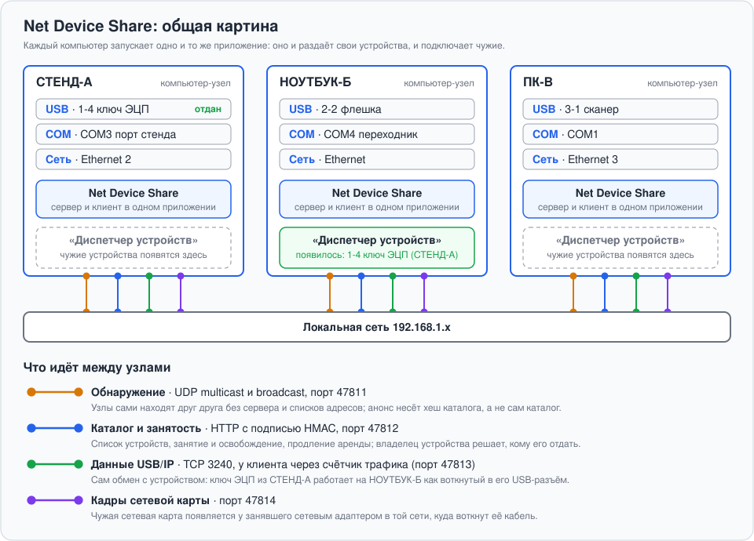
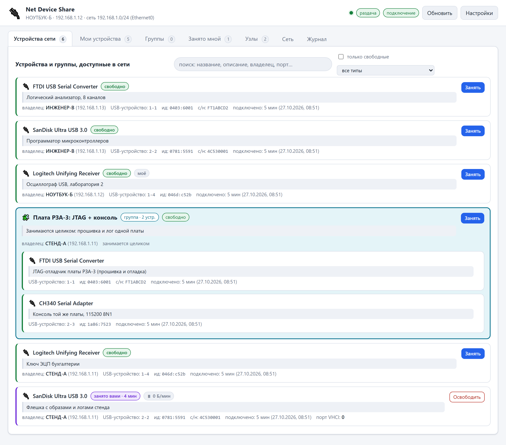
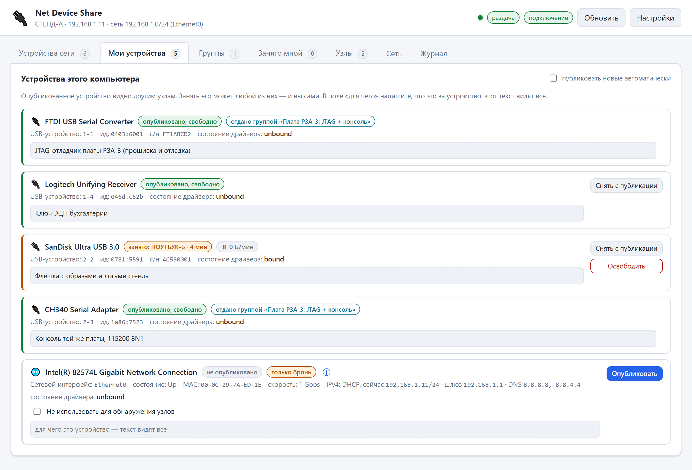
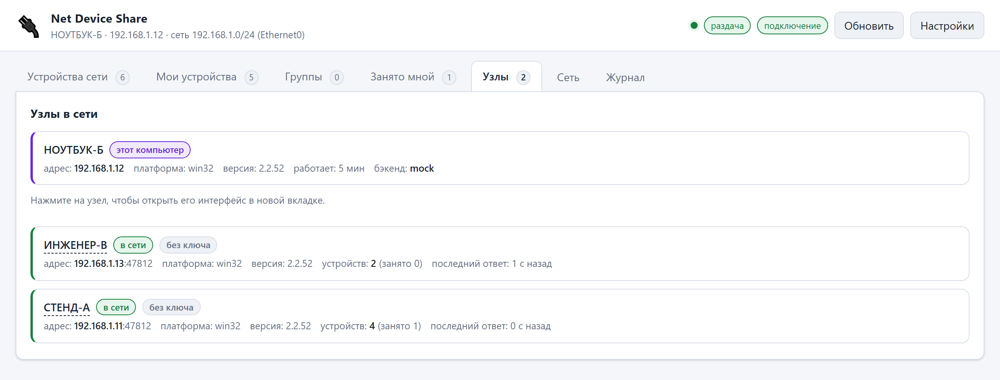
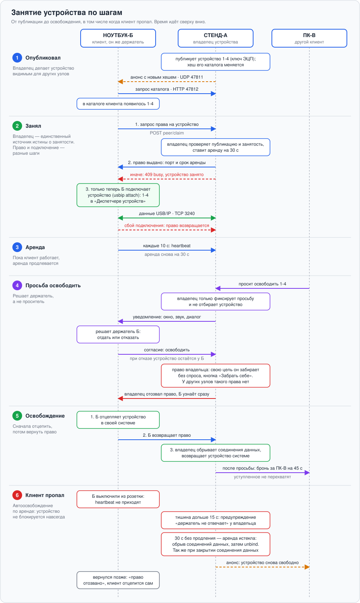
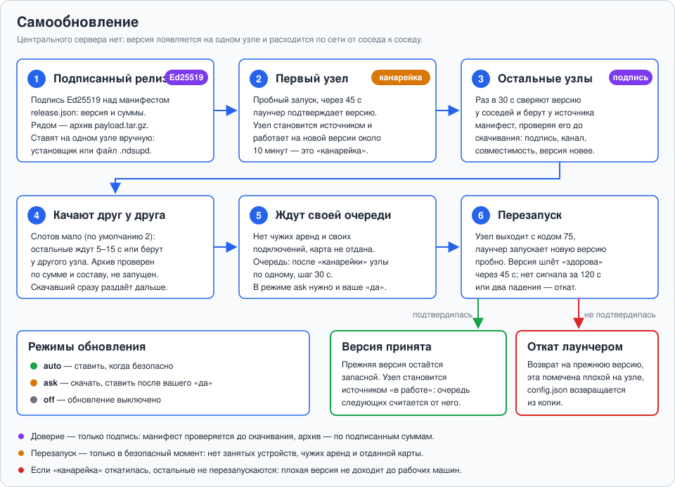
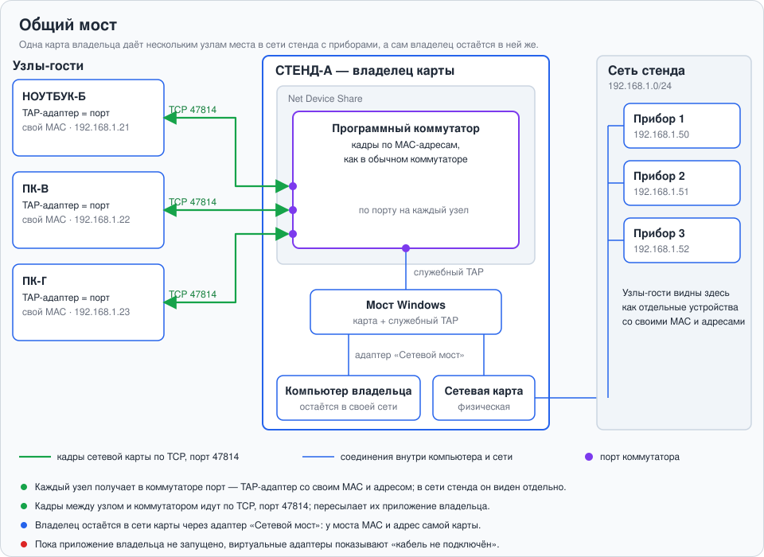
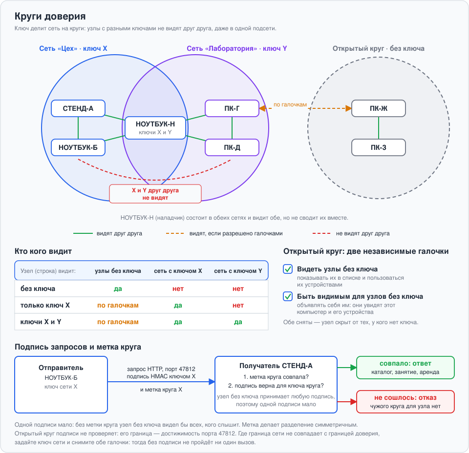
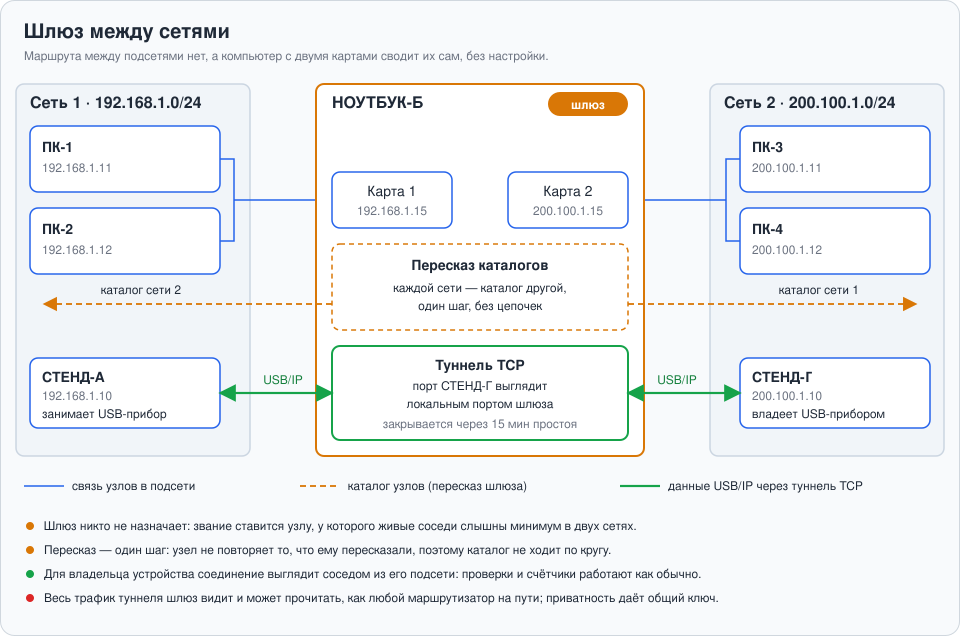

# Net Device Share

Общий доступ к USB-устройствам по локальной сети. Каждый участник запускает одно
и то же приложение: оно одновременно и сервер (раздаёт свои устройства), и клиент
(подключает чужие). Занятое устройство появляется в «Диспетчере устройств» и
работает так же, как воткнутое в USB-разъём этого компьютера.

<p align="center">
  
</p>

## Как это выглядит

Интерфейс — обычная страница в браузере на каждом узле. Ниже — три узла в режиме
имитации (устройства вымышлены, адреса условные): каталог всей сети, свои
устройства узла и список соседей.

<p align="center">
  
</p>

<table>
  <tr>
    <td width="50%"></td>
    <td width="50%"></td>
  </tr>
  <tr>
    <td align="center"><sub>«Мои устройства»: публикация и описание</sub></td>
    <td align="center"><sub>«Узлы»: кто есть в сети</sub></td>
  </tr>
</table>

---

## Что уже работает

* **Четыре типа устройств**: USB, последовательные порты (COM), параллельные (LPT)
  и сетевые интерфейсы — именно интерфейсы, а не карты, поэтому виртуальные
  адаптеры видны по отдельности. TAP-адаптеры и мост самого приложения в
  каталог не попадают: это проводка проброса, а не устройства.
* **Проброс сетевой карты** (Windows): чужая карта появляется у вас сетевым
  адаптером в той сети, куда воткнут её кабель.
* **Сеть компьютера** (Windows, вкладка «Сеть»): карта связей адаптеров — мост,
  коммутаторы, карты, отданные и взятые по сети, брони; программные
  коммутаторы и виртуальные адаптеры со своими MAC и адресами — как у
  коммутатора Hyper-V, но без Hyper-V; настройки IP, MAC и типа сети.
  Адаптеры других программ (OpenVPN, VirtualBox) и сами карты тоже
  переименовываются, отключаются, меняют MAC, соединяются коммутатором;
  программные — удаляются. С другого компьютера — после входа по паролю.
* **Автообнаружение узлов** во всех настоящих сетях компьютера — без сервера,
  конфигураций и списков адресов. Новый компьютер виден остальным за
  несколько секунд.
* **Шлюз между сетями**: компьютер с двумя картами сам пересказывает каждой
  сети каталог другой, а без маршрута между сегментами пропускает данные
  через туннели — порт чужого узла выглядит локальным портом шлюза.
* **Общий мост** (Windows): одну карту владельца используют сразу несколько
  узлов — каждый получает порт в коммутаторе, владелец остаётся в своей сети;
  свободный адрес подключающемуся предлагается по сканированию сети.
* **Единый каталог** всей сети: своё и чужое в одном списке.
* **Группы устройств** — составное устройство: JTAG и COM одной платы занимаются
  целиком и атомарно. Группа публикуется отдельной кнопкой; пока она не
  опубликована, её устройства живут обычной жизнью — публикуются и занимаются
  по отдельности.
* **Описания**: для каждого устройства и каждой группы пишется, что это и для
  чего используется; текст видят все узлы сети.
* **Учёт занятости**: видно, кто именно занял и как давно.
* **Активность обмена** — байт в минуту по каждому устройству и группе:
  сразу видно, работают с устройством или просто держат занятым.
* **Поиск по каталогу** — сразу по названию, описанию, владельцу, порту и
  серийному номеру; слова ищутся в любом порядке.
* **Запросы на занятое**: у держателя можно попросить освободить. Ему всплывает
  системное уведомление поверх окон, звук и диалог в интерфейсе; решает он.
* **Право владельца**: своё устройство владелец забирает без спроса.
* **Аренда с автоосвобождением**: клиента выключили из розетки — устройство
  освободится само.
* **Пароль для доступа с других компьютеров**: без него — только просмотр,
  с ним — полное управление. На самой машине пароль не нужен.
* **Изоляция сетей** общим ключом: узлы с разными ключами не видят друг друга.

> **Про проброс данных.** Пробрасываются **USB** и **сетевые карты** (на
> Windows). Занятое USB-устройство появляется в «Диспетчере устройств».
> Занятая сетевая карта появляется у занявшего **сетевым адаптером**,
> подключённым к сети за картой владельца, **с теми же настройками IP**, что
> были у карты: DHCP или тот же адрес, маска, шлюз и DNS — устройства стенда
> видят привычный адрес. Шлюз и DNS стенда ставятся с пониженным приоритетом и
> не перехватывают ваш собственный выход в сеть. Настройки карты видны в
> каталоге, а у занятой — какие перенесены. У владельца карта на это время
> отдана — её настройки вернутся после освобождения.
>
> Настройки занятой карты держатель может поменять под себя — кнопка
> **«Настройки IP»** на вкладке «Занято мной». У проброшенной карты меняется
> ваш адаптер; у забронированной — сама карта у владельца, и при освобождении
> она получает прежние настройки обратно. Свой адаптер приложение делает
> «частной» сетью и объявляет его адреса в сеть владельца — иначе приборы
> стенда не достучались бы до серверов, запущенных у вас (см. раздел
> [«Сеть компьютера»](#сеть-компьютера-коммутаторы-и-виртуальные-адаптеры)).
>
> COM и LPT **бронируются** — приложение учитывает, кто их занял, но данные по
> сети не передаёт: для COM нужен драйвер виртуального порта у клиента, у LPT
> сетевого стандарта не существует. Бронируются и те сетевые карты, которые
> пробросить нельзя: Wi-Fi, программные адаптеры и карта, через которую
> работает само приложение. В интерфейсе такие устройства помечены как
> «только бронь» (в подсказке — почему), и кнопка у них называется
> **«Забронировать»**, а не «Занять»: нового устройства в системе после
> нажатия не появится, и ждать его не нужно.

---

**Метрики для Prometheus и дашборд Grafana** — выключены по умолчанию, включаются на любом узле; узел отдаёт всю сеть со статистикой по каждому узлу. См. [docs/METRICS.md](docs/METRICS.md), готовый дашборд — [docs/grafana/net-device-share.json](docs/grafana/net-device-share.json).

## Быстрый старт

**Windows, из исходников (сборка и установка одним файлом):** двойной клик по
`build&install.bat` в корне проекта. Он проверит Node.js (нужен только для сборки) и
Inno Setup 6, при необходимости поставит их сам, соберёт установщик в
`dist\installer\` и запустит установку (Windows спросит права администратора).
`build&install.bat --silent` ставит без окон мастера (автозапуск, правила брандмауэра, ярлык на рабочем столе) и сразу запускает программу; `--no-install` только собирает.
Установленной программе Node.js не нужен: `node.exe` едет в комплекте, а
драйверы USB/IP она доустанавливает сама. Подробности — [docs/UPDATE.md](docs/UPDATE.md); как новая версия сама проходит по сети от узла к узлу — в разделе «Как версия проходит по сети».

**Windows, готовый комплект:** распакуйте `net-device-share-<версия>-win-x64.zip`
и запустите `start.bat` из него. Внутри лежит `node.exe`, поэтому ставить Node.js
на машину не нужно — это путь для компьютеров, где установка ПО согласуется
отдельно. Как собрать архив — в разделе [«Сборка комплекта»](#сборка-комплекта-для-windows).

**Только запустить из исходников** (без сборки): `scripts\start.bat` — он проверит
Node.js, запросит права администратора и запустит приложение. Самообновление в
таком режиме выключено.

**Любая система:**

```
node src/main.js
```

Откроется браузер с интерфейсом на `http://127.0.0.1:47812/`.
Зависимостей нет — `npm install` не требуется, нужен только Node.js 20.6 или новее.

Перед первым запуском полезно проверить окружение:

```
node src/main.js --doctor
```

Команда покажет, какие интерфейсы доступны, какая подсеть выбрана, найдены ли
утилиты USB/IP и какие устройства видит система.

Отдельно есть проверка файловых инвариантов — тех, что не видны в diff и
не проявляются до запуска (кодировка и переводы строк `start.bat`, BOM у
скриптов PowerShell, контрольные суммы вложенных установщиков):

```
npm run check
```

Прогоняйте её после массовых правок: `sed -i` в Git Bash срезает CR, и
`start.bat` после такого молча перестаёт работать.

### Попробовать без драйверов

```
node src/main.js --backend mock --name СТЕНД-1
```

Режим имитации поднимает четыре вымышленных устройства и позволяет полностью
пройти сценарий «опубликовал → занял → освободил» между настоящими компьютерами
в настоящей сети. Реального проброса при этом не происходит.

Флаг `--backend` действует **только на текущий запуск** и в файл настроек не
пишется: иначе один запуск с `--backend mock` закреплял бы имитацию навсегда.
Остальные ключи (`--name`, `--network`, порты) по-прежнему запоминаются — там
ожидание ровно обратное.

Если приложение показывает «Режим имитации USB/IP», а флага при запуске нет,
значит в `config.json` осталось поле `"backend": "mock"` от прежних версий.
Приложение само скажет об этом и укажет путь к файлу: замените значение на
`"auto"` и перезапустите.

---

## Установка драйверов USB/IP

Само по себе приложение не может создать устройство в «Диспетчере устройств» —
это делает драйвер уровня ядра. Поэтому приложение опирается на готовые
реализации USB/IP:

| Роль | Windows | Linux |
|---|---|---|
| раздача своих устройств | [usbipd-win](https://github.com/dorssel/usbipd-win) | модуль `usbip_host` |
| подключение чужих | [usbip-win2](https://github.com/vadimgrn/usbip-win2) | модуль `vhci_hcd` |

**Ставить вручную ничего не нужно, и нажимать тоже.** Всё необходимое лежит в
каталоге [`installers/`](installers/) и доустанавливается **при запуске**:

| Компонент | Зачем |
|---|---|
| Node.js 24.21.0 | среда выполнения — для запуска из исходников |
| usbipd-win 5.3.0 | раздача своих устройств |
| usbip-win2 0.9.8.0 | подключение чужих устройств |

Уже установленное не трогается. Интернет не нужен: файлы внутри, а перед
установкой сверяются контрольная сумма и подпись. Отключается галочкой
**«Ставить недостающее при запуске»** в настройках — тогда остаётся кнопка
**«Установить»** в сообщении о неполном окружении.

Файлы установщиков лежат прямо в репозитории и в переносимом комплекте — это и
нужно для цехов и изолированных сегментов сети, где интернета нет вовсе.
Обновить их до новых версий можно скриптом:

```
npm run fetch-installers
```

Он берёт файлы по адресам из [`installers/manifest.json`](installers/manifest.json)
и сверяет SHA-256.

> usbipd-win и usbip-win2 распространяются под **GPL-3.0**. Сборки не изменены,
> их происхождение и адреса исходных текстов указаны в
> [installers/README.md](installers/README.md).

Перед запуском приложение сверяет **SHA-256** каждого файла с манифестом и
проверяет **подпись Authenticode**; не сошлось — установка отменяется целиком.
Установщики запускаются напрямую, с повышением прав: запрос UAC придёт на
каждый компонент, зато в окне видно издателя установщика.
Подробности и способ проверить файлы самостоятельно — в
[installers/README.md](installers/README.md).

Приложение проверяет обе роли по отдельности и честно показывает в шапке,
что доступно: можно раздавать устройства, не имея возможности подключать чужие.

Ручная установка, правила брандмауэра и разбор неполадок —
в [docs/WINDOWS-SETUP.md](docs/WINDOWS-SETUP.md).

---

## Как этим пользоваться

1. **Опубликовать своё устройство.** Вкладка «Мои устройства» → «Опубликовать».
   Там же в поле «для чего» напишите, что это за устройство: текст увидят все.
   USB-устройство остаётся доступным вашей системе — драйверу-заглушке оно
   передаётся только в момент, когда его кто-то занимает.
2. **Собрать группу.** Вкладка «Группы» → «Создать группу». Отметьте устройства,
   которые имеет смысл занимать только вместе, и опишите стенд. Новая группа
   публикуется сразу; кнопкой «Снять с публикации» её можно временно распустить —
   тогда устройства снова доступны по отдельности. В каталоге группа показывается
   рамкой другого цвета, внутри которой видны её устройства, а кнопка «Занять»
   стоит справа, как у обычных карточек.
   **Найти нужное** в большом каталоге помогает строка поиска над списком: она
   ищет сразу по названию, описанию, владельцу, номеру порта и серийному номеру,
   причём слова можно вводить в любом порядке.
3. **Занять.** Вкладка «Устройства сети» → «Занять». Для USB через несколько
   секунд устройство появится в «Диспетчере устройств».
4. **Попросить занятое.** Если цель занята, вместо «Занять» будет «Попросить».
   Держателю всплывёт системное уведомление поверх окон, прозвучит сигнал и
   откроется диалог. Согласится — цель освободится и на 45 секунд придержится
   за вами, чтобы её не перехватили.
5. **Забрать своё.** Владелец видит у занятой чужими цели кнопку «Забрать себе»:
   она отбирает устройство без запроса. Прежнему держателю сообщается сразу.

Пока цель занята, клиент каждые 10 секунд продлевает аренду. Пропала связь —
владелец освободит её по истечении срока (по умолчанию 30 с).

<details>
<summary><b>Схема: жизнь занятия от публикации до освобождения</b></summary>

<p align="center">
  
</p>

</details>

### Запуск службой при загрузке системы

Галочка в настройках — «Запускать как службу при загрузке системы». Применяется
сразу и требует одного подтверждения UAC: создать задание может только
администратор. Установщик делает то же самое выбором пункта «Запускать как
службу» и сразу запускает задание, поэтому после установки второго запроса UAC
нет.

Почему планировщик заданий, а не привычные способы:

| Способ | Права при запуске | Годится? |
|---|---|---|
| реестр `Run`, папка автозагрузки | обычные | **нет**: `usbipd bind` требует администратора, публикация устройств не заработает |
| планировщик от имени пользователя, «с наивысшими правами» | администратора — только если он сам администратор | нет: у обычных пользователей приложение не стартует |
| планировщик от имени **SYSTEM**, при загрузке | SYSTEM, ещё до входа в систему, у любого вошедшего | **да, выбран** |
| служба Windows | то же | Node не служебный исполняемый файл — нужна обёртка вроде nssm; задание SYSTEM даёт то же без зависимостей |

Задание называется `NetDeviceShare`, срабатывает при **загрузке системы** (через
30 секунд) и при входе любого пользователя (при работающем приложении это
ничего не делает) и запускает [`scripts/autostart.bat`](scripts/autostart.bat) — тот же запуск, что
и `start.bat`, но без повышения прав (они уже есть), без открытия браузера и
без `pause`.

#### Каталог настроек

У SYSTEM свой профиль, поэтому у установленного приложения настройки общие —
`%ProgramData%\NetDeviceShare`. Для комплекта, распакованного вручную в
защищённую папку, рядом с `autostart.bat` кладётся `autostart.home` с путём
настроек того, кто включил автозапуск: имя, ключи и nodeId сохраняются.

#### Папка должна быть защищена от записи

Задание от SYSTEM исполняет файлы из каталога приложения. Если обычные
пользователи могут туда писать (распаковали на рабочий стол, `C:\nds` с
правами по умолчанию), любой из них подменил бы `autostart.bat` и получил SYSTEM.
Поэтому в такой папке задание от SYSTEM не создаётся: включается прежний
режим — при входе, от имени включившего, и работает только если у него есть
права администратора. Настройки об этом говорят прямо. Для службы ставьте
программу установщиком (Program Files).

#### Окно консоли не появляется

В режиме SYSTEM окна нет вовсе (сеанс 0). В прежнем режиме задание создаётся как **S4U** — «выполнять независимо от входа
пользователя», но без хранения пароля. Приложение работает в неинтерактивном
сеансе, поэтому окна консоли нет вовсе. Учётная запись остаётся ваша: те же
настройки, тот же `%APPDATA%`.

Это настройка планировщика, а не трюк с сокрытием окна. Обёртки вроде
скрытого `wscript` или `powershell -WindowStyle Hidden` в проекте не
используются: они неотличимы от того, чем пользуются вредоносные программы,
и приложение начинает ловить претензии антивирусов.

Если учётной записи не хватает права «Вход в качестве пакетного задания»,
приложение откатится на прежний способ — с окном — и скажет об этом в
настройках и в журнале.

#### Как посмотреть, что оно делает

Окна нет, поэтому «консоль» — это веб-интерфейс:

```
http://127.0.0.1:47812/
```

Вкладка **«Журнал»** показывает то же самое, что печаталось бы в окне.
Разово, не открывая браузер:

```
schtasks /Query /TN NetDeviceShare /V /FO LIST     состояние задания
curl http://127.0.0.1:47812/api/v1/logs            последние записи журнала
```

#### Как остановить и запустить

```
schtasks /End /TN NetDeviceShare         остановить сейчас
schtasks /Run /TN NetDeviceShare         запустить сейчас
schtasks /Delete /TN NetDeviceShare /F   убрать автозапуск совсем
```

Первые две команды требуют администратора — задание принадлежит SYSTEM.
Ярлык «Net Device Share» запускать службу умеет сам (и ждёт её ответа), а
запрос прав показывает только когда задания нет. Снять автозапуск проще
галочкой в настройках: она делает то же самое.

Запущенное вручную из `start.bat` приложение останавливается как обычно —
Ctrl+C или закрытием окна.

#### Ограничение

В прежнем режиме (папка не защищена) задание срабатывает только при входе
пользователя. Стенд, который должен раздавать устройства с никем не занятой
машины, ставьте установщиком: там задание стартует при загрузке.

Состояние галочки читается у самого планировщика, а не из конфигурации:
задание могли удалить мимо приложения, и показывать «включено» на основании
собственной записи значило бы врать.

На Linux то же самое делается пользовательским юнитом systemd
(`~/.config/systemd/user/net-device-share.service`), root там не нужен.

### Зачем кнопка «Обновить»

В обычной работе — незачем: каталог, занятость и запросы приходят сами, список
устройств перечитывается раз в 4 секунды, соседи объявляются раз в 3.

Она нужна там, где таймеры бессильны:

| Действие | Происходит само? |
|---|---|
| перепроверить окружение USB/IP | **нет** — только при старте и после установки |
| сверить занятия с реальным состоянием VHCI | **нет** — только при старте |
| сбросить кеш COM, LPT и сетевых интерфейсов | **нет** — они кешируются на 15 с |
| перечитать устройства и опросить соседей | да, просто раньше |

Практически это три случая: **доставили usbipd или usbip, не перезапуская
приложение** (без этого приложение до перезапуска считает, что их нет);
**кто-то вмешался мимо приложения** — сделал `usbip attach` из консоли или
подключение отвалилось; **только что воткнули USB-переходник** и хотите увидеть
новый COM-порт сразу, а не через пятнадцать секунд.

### Обновление по сети

Центрального сервера обновлений нет: новая версия появляется на одном узле и
расходится по сети от соседа к соседу. Каждый шаг проверяется подписью релиза
(Ed25519) ещё до скачивания; перезапуск — только в безопасный момент, а версия,
которая не подтвердилась, откатывается лаунчером. Подробности — в
[docs/UPDATE.md](docs/UPDATE.md).

<p align="center">
  
</p>

---

## Сеть компьютера: коммутаторы и виртуальные адаптеры

Вкладка **«Сеть»** (Windows) — то, что раньше делалось в «Сетевых
подключениях» и утилите VirtualNics, но без Hyper-V: из TAP-адаптеров, моста
Windows и программного коммутатора приложения.

**Карта** показывает, как соединены адаптеры: физические карты, мост,
коммутаторы, виртуальные адаптеры, чужие карты, занятые этим компьютером
(пунктир от владельца), свои карты, отданные по сети (пунктир к занявшему),
и брони (точки к держателю). Щелчок по узлу ведёт к его карточке с кнопками.

**Коммутатор** соединяет адаптеры этого компьютера кадрами по MAC, как
обычный коммутатор.

* *Внешний* — с физической картой: карта и служебный адаптер коммутатора
  собираются в мост Windows, и всё, что подключено к коммутатору, оказывается
  в сети карты. Сам компьютер остаётся в этой сети через адаптер «Сетевой
  мост»: при создании на него переезжает адрес карты (галочка «Оставить этому
  компьютеру доступ к сети карты»), а MAC у моста — MAC карты, так что и DHCP
  выдаёт прежний адрес. Мост в Windows один — значит, и внешний коммутатор
  один; вторая карта в нём сливает две сети в одну.
* *Внутренний* — без карты: соединяет только адаптеры этого компьютера.

**Виртуальный адаптер** — обычный сетевой адаптер Windows (он виден в
«Сетевых подключениях» и «Диспетчере устройств») со своим MAC, адресом и типом
сети, включённый в коммутатор. Так компьютер выглядит в сети стенда
несколькими устройствами. MAC — случайный или заданный; драйвер TAP принимает
только локальные MAC (первый байт 02, 06, 0A…), заводской адрес настоящей
карты он не примет. Кадры между портами коммутатора пересылает приложение:
пока оно не запущено, виртуальные адаптеры — «кабель не подключён», а мост и
настройки остаются. Адаптер создаётся и удаляется по одному: остальные
TAP-адаптеры (в том числе у работающего проброса и у OpenVPN) при этом не
перезапускаются.

**Адаптеры, созданные не приложением** — сами карты, адаптеры OpenVPN,
VirtualBox, Hyper-V — управляются там же, кнопками на их карточках:

* **«Изменить…»** — имя и MAC (случайный, заданный или снова заводской);
  смена MAC перезапускает адаптер. Драйвер TAP берёт только локальные MAC
  (02-…), драйверы карт — обычно любые.
* **«Отключить» / «Включить»** — как в «Сетевых подключениях».
* **«Удалить»** — только программные адаптеры: физическую карту Windows
  найдёт снова (её отключают), адаптер Hyper-V удаляется вместе с его
  коммутатором в Диспетчере Hyper-V.
* **Соединить коммутатором.** Чужой TAP-адаптер подключается к коммутатору
  портом, как виртуальный: кнопкой «К коммутатору…» на его карточке,
  «Подключить адаптер» на карточке коммутатора или сразу при создании
  коммутатора — там есть список «Адаптеры, которые уже есть». Так несколько
  уже существующих адаптеров соединяются в одну сеть. Пока адаптер
  подключён, другая программа (OpenVPN) открыть его не может; адаптер,
  который она держит, не подключится — приложение так и скажет. «Отпустить»
  возвращает его. Прочие адаптеры (VirtualBox и т. п.) входят в коммутатор
  мостом Windows, как карта.

Нельзя: трогать рабочую карту приложения (кроме типа сети) и занятую карту,
переименовывать опубликованную (её имя — её адрес в каталоге) и служебные
адаптеры приложения. Почему — написано на карточке и в окне «Изменить…».

**Настройки IP** — DHCP или адреса (несколько, по одному в строке
«адрес/префикс»), шлюз, DNS и тип сети — у любого адаптера, кроме трёх
случаев: рабочей карты приложения (новый адрес оборвёт связь и с этой
страницей — меняйте его на месте), карты в мосту (её адрес не действует, он у
моста) и служебных адаптеров моста.

**Отданная карта.** Пока карта отдана, на адаптере моста IP выключен: адрес
карты — у занявшего. Чтобы владельцу остаться в той же сети, включите IP на
мосту и задайте свой адрес, другой. При освобождении всё вернётся как было.
Карту, включённую в коммутатор, тоже можно отдать: занявший попадает в сеть
коммутатора, но адрес задаёт себе сам — адрес карты занят владельцем.

**Общий мост.** Одну карту можно отдать не одному узлу, а нескольким сразу:
каждый подключается к программному коммутатору владельца отдельным портом (у
себя это TAP-адаптер со своим MAC и адресом) и оказывается в сети карты, а
владелец остаётся в ней через адаптер «Сетевой мост». Свободный адрес
подключающемуся предлагается по сканированию сети.

<p align="center">
  
</p>

Всё, что меняет сеть, требует прав администратора; без них вкладка только
показывает. С другого компьютера вкладка открывается после входа по паролю.

### Если устройства стенда не видят серверы, запущенные у вас

Проверено на стенде; причины — по убыванию вероятности.

1. **Тип сети «общедоступная».** Новый адаптер Windows относит к
   общедоступной сети, и сетевой экран режет на нём входящие: ping, ваши
   серверы — всё. Kaspersky Endpoint Security берёт тип сети у Windows (на
   стенде входящий ping пошёл сразу после перевода сети в «частную»).
   Приложение ставит своим адаптерам «частную» само, как только Windows
   опознает сеть; на карточке адаптера это видно. Если сторонний экран всё
   равно режет — в нём: «Сетевой экран → Сети», статус сети адаптера
   «Локальная сеть».
2. **Прибор помнит адрес за старым MAC.** Если адрес раньше был у карты
   владельца, прибор шлёт кадры на её MAC, пока не устареет запись ARP — у
   приборов это бывает и двадцать минут. Windows новый адрес в сеть не
   объявляет; приложение объявляет его само (gratuitous ARP) — при занятии и
   при каждом новом адресе адаптера, в том числе заданном в свойствах Windows.
3. **Правило сетевого экрана для самого сервера.** Программа-сервер должна
   быть разрешена для частных сетей.

MAC карты владельца адаптеру занявшего присвоить нельзя: драйвер TAP
принимает только локальные MAC. Нужно несколько MAC в сети стенда — создайте
виртуальные адаптеры в коммутаторе на этой карте.

---

## Доступ с других компьютеров

Интерфейс доступен по адресу узла в сети, например `http://192.168.1.50:47812/`.

| Откуда | Что доступно |
|---|---|
| с самого компьютера (`127.0.0.1`) | всё, без пароля |
| с другого компьютера без пароля | только просмотр: каталог, занятость, описания |
| с другого компьютера после входа | всё |

Вкладка «Сеть» и всё, что меняет сеть, доступны только при полном доступе.

Пароль задаётся в настройках **на том компьютере, где запущено приложение**,
и хранится только как scrypt-хеш. Сессия живёт 12 часов в cookie с подписью;
список выданных сессий нигде не хранится — подпись проверяется вычислением.

Разделение «локально всё, извне по паролю» отражает простой факт: у того, кто
сидит за этой машиной, и так есть все возможности — он может выдернуть
устройство из разъёма. Требовать с него пароль бессмысленно.

---

## Параметры запуска

```
--name <имя>            имя узла в сети (по умолчанию — имя компьютера)
--network <CIDR>        рабочая сеть, например 192.168.1.0/24 (по умолчанию auto)
--key <строка>          общий ключ: узлы с разными ключами не видят друг друга
--api-port <порт>       HTTP: интерфейс и RPC между узлами (47812)
--discovery-port <порт> UDP: обнаружение узлов (47811)
--usbip-port <порт>     TCP: данные USB/IP (3240)
--backend <тип>         auto | windows | linux | mock
--log-level <уровень>   error | warn | info | debug | trace
--no-open               не открывать браузер
--doctor                проверить окружение и выйти
--networks              показать доступные подсети и выйти
```

Значения сохраняются: достаточно один раз запустить с `--name`, дальше имя
закрепится. Всё то же самое меняется в интерфейсе, в «Настройках».

Конфигурация лежит в `%APPDATA%\net-device-share\config.json` (Windows) или
`~/.config/net-device-share/config.json` (Linux). Переменная `NDS_HOME`
позволяет задать свой каталог — так на одной машине запускается несколько
независимых экземпляров.

---

## Выбор рабочей сети

Обнаружение идёт во всех настоящих сетях компьютера: узел объявляет себя и
принимает анонсы в каждой из них, а виртуальные адаптеры Hyper-V, WSL и TAP
чужих программ не используются, чтобы не анонсироваться «не туда». Отдельную
карту можно исключить галочкой «Не использовать для обнаружения» в настройках.

Вызовы с адресов любой из сетей принимаются по одним и тем же правилам кругов
доверия: кто без ключа — смотрите [«Узлы без ключа»](#узлы-без-ключа), у кого
ключ совпадает — свои.

По умолчанию узел работает во всех настоящих сетях, кроме автоадресов 169.254
(в том числе в подсети прямого кабеля с любым адресом, не только из частных
диапазонов); основной считается частная сеть, виртуальные адаптеры берутся,
только если настоящих нет. Список доступных вариантов:
`node src/main.js --networks`.

**Кто шлюз.** Никто не назначает и не выбирает его: узел, у которого живые
соседи слышны минимум в двух сетях, объявляет об этом (поле `nets`) и сам
пересказывает каталог между сетями. Звание «живое»: оборванный кабель или
выключенный компьютер на другом конце снимают его за секунды (проверка сетей —
раз в 5 с, объявление — сразу при изменении), даже если сама карта осталась
поднятой. Таких узлов может быть несколько. Признак виден как «🌉 шлюз» —
у самого узла (шапка, «Узлы», владелец в каталоге) и у соседей.

---

## Сети с общим ключом

Ключ делит сеть на непересекающиеся круги доверия: узлы с разными ключами
**не видят друг друга**, даже находясь в одной подсети. Один узел может
состоять сразу в нескольких таких сетях — например, в «Цехе» и в
«Лаборатории», — и в каждой его видят только те, у кого тот же ключ.

Настройки → **«Сети с общим ключом»** → «Добавить сеть». У каждой записи
своё название и свой ключ:

| | |
|---|---|
| название | ваше, местное; нигде не передаётся и служит подписью в списке узлов |
| ключ | любые печатаемые символы, не короче 8 |
| пробелы по краям | отбрасываются |
| сравнение | посимвольное, точное |
| сколько сетей | до восьми |

Про пробелы отдельно: ключ переносят копированием, и вместе с ним нередко
приезжает перевод строки. Отличие невидимо, а узлы после этого молча
перестают видеть друг друга — подпись не сходится, и понять почему нельзя,
ключ ведь «тот же самый». Поэтому края обрезаются.

**Кнопка «Ключ»** в строке сети создаёт ключ вида

```
K7M2P-9XQTR-4HJBW-N5VYC-8ZDFG
```

Это 125 случайных бит. Алфавит — 32 знака без похожих друг на друга: нет
`O` и `0`, `I` и `1`. Весь ключ в верхнем регистре, поэтому строчная `l`
в нём не встречается. Такой ключ можно продиктовать по телефону.

Сохранённый ключ больше не показывается: пустое поле при правке означает
«оставить прежний», так что переименовать сеть можно, не зная её ключа.
Чтобы сверить ключи на двух компьютерах, не называя их, есть **отпечаток**
рядом с каждой сетью — он совпадает там, где совпадают ключи. Восстановить
по нему ключ нельзя, и ничего нового он не раскрывает: тот же отпечаток
едет в каждом анонсе открытым текстом.

Состав сетей применяется сразу, перезапуск не нужен.

### Узлы без ключа

Компьютеры, на которых ключ не задан, образуют **открытый круг** — такую же
сеть, только без проверки подписи. Участие в нём разделено на две половины,
и они независимы:

| Галочка | Что делает |
|---|---|
| **Видеть узлы без ключа** | показывать их в списке и пользоваться их устройствами |
| **Быть видимым для узлов без ключа** | объявлять себя им: они увидят этот компьютер и его устройства |

Осмысленны все четыре сочетания:

* **обе включены** — как было до появления ключей;
* **обе выключены** — узел полностью скрыт от тех, у кого ключа нет;
* **только «видеть»** — пользуемся их устройствами, себя не показываем;
* **только «быть видимым»** — отдаём свои устройства всем, чужих не показываем.

Открытый круг — сознательный выбор в угоду простоте: поставил — и работает,
в том числе между сегментами сети и через узел-шлюз. Границей круга служит
достижимость порта: всякий, чей вызов дотянулся до 47812, входит наравне со
всеми, откуда бы он ни пришёл. Для цеха за одним роутером это приемлемо; где
граница сети не совпадает с границей доверия — задайте ключ сети и снимите
обе галочки: тогда без подписи не пройдёт ни один вызов, ни из какой сети.

У режима «вижу, но не показываюсь» есть особенность, которую стоит понимать:
не объявляя себя, нельзя и попросить соседей представиться — такой запрос сам
был бы объявлением. Поэтому тихий узел без ключа появится в списке не сразу,
а с его очередным анонсом (см. «Нагрузка на сеть»).

### Кто кого видит

Разделение симметричное и держится не на подписи, а на метке круга доверия:
узел **без** ключа принимает любую подпись, поэтому одной подписи было бы мало.

<p align="center">
  
</p>

| | узлы без ключа | сеть с ключом X | сеть с ключом Y |
|---|---|---|---|
| без ключа | да | нет | нет |
| только ключ X | по галочкам | да | нет |
| ключи X и Y | по галочкам | да | да |

Узел, состоящий и в X, и в Y, видит обе сети — но сами X и Y друг друга
по-прежнему не видят: он не сводит их вместе, а лишь состоит в обеих.

Это относится и к адресам в «Узлах в других сетях»: прежде чем отдать
каталог, приложение выясняет круг доверия того узла и при несовпадении не
отправляет ничего. Иначе ключ обходился бы простым вписыванием адреса.

Каждый узел в списке подписан своей сетью. Если ключей нет вовсе и обе
галочки сняты, приложение так и скажет: узел не состоит ни в одном круге —
он никого не увидит и никому не будет виден.

---

## Несколько сегментов сети

Узлы находят друг друга широковещательными запросами, а те не выходят за
пределы подсети: broadcast маршрутизаторы не пропускают, multicast в
корпоративных сетях обычно закрыт. Поэтому без настройки компьютеры из
разных сегментов друг друга **не видят** — даже когда маршрут между ними
есть и пинг ходит.

Чинится одним адресом. Настройки → «Узлы в других сетях» → адрес любого
узла из соседнего сегмента:

```
10.2.0.7
stend-2.local:47812
```

Дальше приложения обменяются списками узлов и расскажут о них своим соседям
по подсети. **Настроить достаточно одну сторону** — обмен двусторонний.
Хватает одного адреса на сегмент: остальные узлы того сегмента подтянутся
сами.

### Что через этот узел идёт

Знакомство — всегда: списки узлов пересказываются по цепочке, и каждый узел
обращается к владельцу устройства напрямую, по его собственному адресу.
Нагрузка на узел, указанный в настройках, от этого не растёт — это один
небольшой запрос раз в двадцать секунд.

Если маршрута между сегментами нет вовсе, его заменяет **узел-шлюз** —
компьютер, стоящий в обеих сетях (две карты, Wi-Fi + кабель). Он видит обе
сети и сам, без настройки, пересказывает каждой каталог другой, а по запросу
открывает туннели: порт узла из соседней сети показывается у вас как порт
самого шлюза, и данные USB/IP идут через него. Для владельца соединение
выглядит соседом из его подсети, поэтому проверки и счётчики работают как
обычно. Туннель закрывается после 15 минут простоя. Учтите: весь трафик
туннеля шлюз видит и может прочитать — как любой маршрутизатор на пути.

<p align="center">
  
</p>

Звание «шлюз» никто не назначает: его получает узел, у которого живые соседи
слышны минимум в двух сетях. Пропал сосед — звание уходит сразу.

### Что для этого нужно

1. **Общий круг доверия.** Достаточно сети с общим ключом; работает и
   открытый круг («узлы без ключа») — он теперь не ограничен своей подсетью.
   Приватность между сегментами даёт только ключ: без него любой, чей пакет
   дотянулся до порта 47812, входит в круг наравне со всеми.
2. **Маршрут между сегментами** и открытые порты 47812/TCP (управление),
   47813/TCP или 3240/TCP (данные USB) и 47814/TCP (кадры сетевой карты).
   Через NAT приложение не работает: адрес узла должен быть достижим с той
   стороны как есть. Маршрута нет — нужен узел-шлюз в обеих сетях (см. выше).
3. Если используется ключ, он должен совпадать у всех — узлы с разными
   ключами не видят друг друга и внутри одной подсети тоже.

В списке узлов такие компьютеры помечены **«другая сеть»**. Если устройство
видно, а занять его не выходит — смотреть надо туда: значит, каталог дошёл,
а маршрут или порт — нет.

---

## Если узлы не видят друг друга

Сначала посмотрите вкладку «Узлы» и «Журнал», потом идите по списку — причины
расположены по убыванию вероятности.

1. **Узел в списке есть, а устройств у него нет, «последний ответ» растёт.**
   Обнаружение (UDP 47811) доходит, а управление (TCP 47812) закрыто сетевым
   экраном: чаще всего Windows считает сеть «общедоступной». Так бывает на
   прямом кабеле между двумя компьютерами и на картах со статическим адресом
   («Неопознанная сеть»). Переведите сеть в «частную» или создайте правила и для
   профиля Public: `scripts\firewall-windows.ps1 -IncludePublic` (от
   администратора, на **каждом** компьютере). Подробности —
   [docs/WINDOWS-SETUP.md](docs/WINDOWS-SETUP.md).
2. **Вызовы отвечают 401, хотя узел виден.** В сообщении теперь сказана причина:
   *расхождение часов* (допуск подписи — 10 минут, в тексте указан сдвиг),
   *неверный ключ или круг* или *вызов без подписи* (узел принимает только
   подписанные вызовы — нужен общий ключ). Синхронизируйте время; ключи
   сверяйте по отпечатку (см.
   [«Сети с общим ключом»](#сети-с-общим-ключом)).
3. **Две машины никак не видят друг друга, остальные видят обе.** Возможен
   одинаковый идентификатор узла: клон виртуальной машины или скопированный
   профиль. Каждый узел отбрасывает «своё» эхо, поэтому клоны взаимно
   невидимы. В журнале при этом пишется предупреждение о НАШЕМ идентификаторе
   с адреса соседа. Удалите поле `nodeId` из `config.json` на копии и
   перезапустите приложение — оно заведёт новый.
4. **Узел объявляется не в той сети.** Автовыбор берёт настоящие карты и может
   взять ту, что смотрит к провайдеру или к другому стенду. Посмотрите
   `node src/main.js --doctor`, а в «Настройках» задайте сеть вручную
   (см. [«Выбор рабочей сети»](#выбор-рабочей-сети)).
5. **Один сегмент, но разные маски** (например, /24 и /16). Пакеты от адреса
   вне подсети своей карты отбрасываются, и один узел видит другого, а тот
   его — нет. Выровняйте маски или укажите адрес соседа в «Узлах в других
   сетях».
6. **Wi-Fi с изоляцией клиентов или сеть без multicast.** Широковещательные
   пакеты не доходят. Узел из этой сети находится по адресу в «Узлах в других
   сетях»; дальше он пересказывается соседям.
7. **После сна или смены сети узлы пропали.** Приложение само следит за
   сокетами обнаружения: проверка раз в 5 секунд, повтор — с паузой от 10
   секунд до 5 минут. Не помогло — кнопка «Обновить».
8. **После правки `config.json` вручную узел потерял ключи и пароль.** Если
   файл не читается (обрыв, лишние символы), приложение сохраняет его копией
   `config.json.bad-<время>` и пишет ошибку в журнал, прежде чем заводить
   умолчания. BOM после Блокнота или PowerShell теперь не мешает. Ключи и
   пароль можно взять из копии.

Если узел виден в списке, а занять устройство не выходит — каталог дошёл, а
маршрут или порт нет (см. «Что для этого нужно» выше).

---

## Нагрузка на сеть

Анонс присутствия обрабатывает каждый компьютер подсети, поэтому по
умолчанию темп адаптивный: пока состояние меняется, узел объявляется раз в
3 секунды; в покое интервал сам удваивается до 30 секунд. Любое изменение
мгновенно возвращает быстрый темп, а изменение, которое нечего объявлять,
не порождает пакета вовсе. В сравнении с прежним ровным темпом это
примерно десятикратное снижение фонового трафика.

Настраивается в разделе «Темп анонсов»:

| Параметр | По умолчанию | Смысл |
|---|---|---|
| Обычный интервал | 3 с | темп, пока что-то происходит |
| В покое | 30 с | предел, до которого растёт интервал |
| Замедляться в покое | включено | выключение возвращает ровный темп |
| Канал | оба | multicast, broadcast или оба сразу |

**Про канал.** По умолчанию пакет уходит и туда, и туда: где-то режут
multicast, где-то broadcast, и заранее неизвестно, что именно. Если точно
известно, какой работает, второй — это ровно вдвое больше пакетов впустую.

Плата за замедление одна: узел, выключенный без предупреждения (питание,
зависание), будет помечен «не отвечает» позже — примерно через три
пропущенных анонса, то есть до полутора минут на медленном темпе. Корректный
выход отправляет прощальный пакет и виден сразу. На занятость устройств это
не влияет вовсе: там своя аренда со своим сроком.

Для узлов из других сетей есть отдельный параметр — «Опрос этих узлов»
(15 с). Их анонсов не слышно, поэтому об изменениях приходится спрашивать
самим; запрос дешёвый, полный список едет, только если хеш состояния
изменился.

---

## Безопасность

* Управление (интерфейс и его API) — **с самого компьютера или после входа по
  паролю**. Сосед по сети без пароля не может ни переименовать ваш узел, ни
  опубликовать ваши устройства, ни тронуть сеть.
* Каждый изменяющий запрос интерфейса несёт заголовок `X-NDS-UI`. Посторонняя
  страница, открытая в браузере на этом же компьютере, послать его не может, и
  «локальный» доступ ей не достаётся.
* Межузловые вызовы подписываются **HMAC-SHA256** на общем ключе, если он
  задан. Подпись покрывает тело, путь, метод, отправителя и время: перехваченный
  вызов нельзя повторить на другом пути, от чужого имени или позже чем через
  10 минут — часы узлов должны расходиться не сильнее. Пока в сети есть узлы
  старых версий, принимается и прежняя подпись одного тела; галочка
  `strictSignatures` в настройках отключает эту уступку, когда все обновились.
* **Круг доверия** вычисляется из ключа и передаётся в анонсах: узлы с разными
  ключами не видят друг друга вовсе. Без ключа узел считается открытым и
  объединяется с другими открытыми узлами — из любых сетей, куда дотягивается
  порт (см. [«Узлы без ключа»](#узлы-без-ключа)).
* Узел-шлюз, стоящий в двух сетях, пересказывает каталог и пропускает через
  себя туннели — и, как любой маршрутизатор на пути, видит весь этот трафик.
* Право занимать устройство выдаёт только его владелец.

Сам трафик USB/IP **не шифруется** — это свойство протокола. Для работы через
недоверенную сеть пропускайте его через VPN.

---

## Сборка комплекта для Windows

```
npm run build
```

Получается `dist/net-device-share-<версия>-win-x64/` и одноимённый `.zip`
(около 34 МБ). В архиве всё приложение плюс `node.exe`: на целевой машине не
нужны ни Node.js, ни npm, ни сеть.

Версия Node зафиксирована в `scripts/build-release.mjs` вместе с её SHA-256.
Сборка скачивает `node.exe` с nodejs.org, сверяет сумму и кладёт рядом лицензию
Node. Скачанное остаётся в `dist/.cache/`, поэтому повторная сборка идёт без сети.

Оба пусковых файла ищут `node.exe` рядом с собой и предпочитают его тому, что
установлено в системе: комплект должен вести себя одинаково на любой машине.
Если вложенного нет — работают как раньше, через `node` из `PATH`.

**Установщиков usbipd-win и usbip-win2 в архиве нет.** Они под GPL-3.0, и
класть чужие сборки в свой архив — значит принимать на себя обязательства по
выдаче исходных текстов. Вместо них едут `manifest.json` и
`scripts/fetch-installers.mjs`; на машине с интернетом достаточно выполнить

```
node.exe scripts\fetch-installers.mjs
```

а на изолированной — скопировать готовый каталог `installers\windows`.
Контрольные суммы проверяются в обоих случаях.

Без этих драйверов комплект всё равно запускается и работает как каталог
устройств: список, занятость, запросы, группы. Не работает только сам проброс.

Каталог `dist/` в репозиторий не попадает: 90 МБ двоичных файлов там не нужны,
а собрать их заново — одна команда.

---

## Состав проекта

```
src/
  main.js              запуск, разбор аргументов, --doctor
  config.js            конфигурация и постоянная идентичность узла
  log.js               журнал с кольцевым буфером для интерфейса
  net/
    interfaces.js      перечисление интерфейсов, арифметика CIDR
    protocol.js        протокол NDS/1: подпись, круг доверия, хеш состояния
    realms.js          круги доверия узла: ключевые сети и открытый круг
    discovery.js       обнаружение узлов (multicast + broadcast) во всех сетях машины
    rpc.js             HTTP-клиент межузловых вызовов
    tunnels.js         туннели TCP на узле-шлюзе: порт чужой сети как локальный
    netScan.js         сканирование занятых адресов сети карты и предложение свободного
    trafficProxy.js    счётчик трафика USB/IP
    tapRelay.js        TAP-адаптер: посредник и нарезка потока по кадрам
    tapLink.js         канал кадров между машинами, вход по пропуску
    tapAdapters.js     TAP-адаптеры Windows: перечень, создание и удаление; MAC, имя,
                       отключение и удаление любого адаптера
    relayKeeper.js     посредник TAP, который держится поднятым; порт коммутатора
    vswitch.js         программный коммутатор L2 и объявление адреса (ARP)
    bridge.js          мост Windows: очередь операций, IP на мосту
    ipConfig.js        настройки IPv4: из реестра, через netsh, тип сети
    adapters.js        опись адаптеров для карты сети (и можно ли менять MAC), сетевые экраны
  cluster/
    peers.js           реестр соседей, их состояния и таймауты
    directory.js       обмен каталогом узлов между сетями
  devices/
    types.js           типы устройств, составные идентификаторы «тип:ключ»
    hub.js             единый список устройств всех типов
    backend.js         абстракция USB/IP и выбор реализации
    windows.js         usbipd-win + usbip-win2
    linux.js           usbip + sysfs
    ports.js           перечисление COM, LPT и сетевых интерфейсов
    mock.js            имитация для отладки и приёмки
  core/
    shareManager.js    свои устройства: публикация, занятость, группы, запросы
    netShare.js        проброс сетевой карты: отдать мостом, взять адаптером
    netManager.js      вкладка «Сеть»: коммутаторы, виртуальные и чужие адаптеры, права, настройки
    attachManager.js   чужие цели: занятие, аренда, ответы на запросы
    installer.js       установка недостающих компонентов USB/IP
    autostart.js       запуск вместе с системой (планировщик от SYSTEM, systemd)
    app.js             сборка приложения и снимок состояния
  api/httpServer.js    интерфейс, уровни доступа и RPC на одном порту
  ui/                  интерфейс: HTML, CSS, JS без сборки (net.js — вкладка «Сеть»)
build&install.bat      сборка установщика и установка (CP866 + CRLF, менять кодировку нельзя)
scripts/
  start.bat            ручной запуск (в комплекте лежит в корне; CP866 + CRLF)
  autostart.bat        точка входа для планировщика заданий
  build-release.mjs    сборка переносимого комплекта с вложенным node.exe
  check-files.mjs      файловые инварианты: кодировки, переводы строк, суммы
  fetch-installers.mjs загрузка установщиков USB/IP по манифесту
  firewall-windows.ps1 правила брандмауэра для портов приложения
  tap-relay.ps1        посредник TAP-адаптера: кадры через каналы процесса
  net-bridge.ps1       мост Windows командами папки «Сетевые подключения»
  tap-device.ps1       создание и удаление TAP-адаптера по одному (SetupAPI)
  run-linux.sh         запуск на Linux с загрузкой модулей ядра
dist/                  собранные комплекты, в репозиторий не попадают
installers/
  manifest.json        описание вложенных установщиков: суммы, подписанты, команды
  windows/             установщики Node.js, usbipd-win, usbip-win2 (≈61 МБ)
                       и драйвер TAP (tap-windows6 9.27.0, 190 КБ)
  README.md            происхождение файлов и как их проверить
docs/
  HANDOVER.md          передача проекта: состояние, грабли, что не проверено
  ARCHITECTURE.md      устройство и принятые решения
  PROTOCOL.md          формат сообщений и HTTP API
  WINDOWS-SETUP.md     установка драйверов на Windows 10 x64
  img/                 схемы (SVG) и снимки интерфейса для README
```

> Продолжаете работу на другой машине или после перерыва? Начните с
> [docs/HANDOVER.md](docs/HANDOVER.md): там состояние дел, порядок
> развёртывания, список уже собранных граблей и честный перечень того,
> что ещё не проверено на живом железе.

---

## Про кроссплатформенность

Выбран Node.js без единой зависимости и без шага сборки: одни и те же файлы
запускаются на Windows, Linux и macOS. Всё, что зависит от операционной системы,
собрано за интерфейсом `UsbBackend` (`src/usb/backend.js`) — пять методов:
`probe`, `listLocal`, `bind`/`unbind`, `attach`/`detach`, `listAttached`.

Поддержка Linux уже написана (`src/usb/linux.js`) и включается автоматически.
Чтобы добавить macOS, достаточно реализовать те же пять методов — остальной код
(обнаружение, каталог, занятость, интерфейс) менять не придётся.

Интерфейс — обычная веб-страница, поэтому позже его можно завернуть в Electron
или Tauri без переписывания, а сам исполняемый файл собрать через
`node --experimental-sea-config`, если понадобится дистрибутив без Node.js.

---

## Известные ограничения

* Проброс в «Диспетчер устройств» работает ровно настолько, насколько работает
  установленный драйвер USB/IP. Веб-камеры и другие устройства с плотным
  изохронным трафиком по USB/IP исторически капризны.
* Установщик usbip-win2 подписан не автором проекта, а сторонней компанией.
  Подпись действительна, но при установке драйвера ядра это стоит проверить
  самостоятельно — см. [docs/WINDOWS-SETUP.md](docs/WINDOWS-SETUP.md).
* `bind`/`unbind` на Windows требуют прав администратора: запускайте приложение
  от администратора, иначе публикация будет завершаться ошибкой.
* Состав каталога сходится за несколько секунд (интервал анонсов — 3 с).
  Это распределённый список без общего сервера, мгновенной согласованности нет.
* **COM и LPT только бронируются** — данные по сети для них не передаются.
  Учёт занятости при этом настоящий: каталог, описания, группы, запросы и
  аренда работают для них наравне с USB.
* **Сетевая карта пробрасывается мостом Windows**, а мост на компьютере один.
  Поэтому у владельца одновременно отдана может быть только одна карта, и
  приложению нужны права администратора. Кадры по сети идут без шифрования,
  как и данные USB/IP. Проверено между двумя компьютерами; перенос настроек
  IP проверен на одной машине на виртуальных адаптерах.
* **Коммутаторы работают, пока запущено приложение**: кадры между
  виртуальными адаптерами пересылает оно. Внешний коммутатор один — мост в
  Windows один. Проверены на одной машине, где роль карты играл TAP-адаптер;
  с настоящей картой и между двумя компьютерами — ещё нет.
* **Чужой TAP-адаптер в коммутаторе занят приложением**: открыть TAP может
  только одна программа, поэтому OpenVPN им не воспользуется, пока адаптер не
  отпустят; адаптер, который держит OpenVPN, не подключится. Смена MAC у
  настоящей карты на живой карте не проверялась.
* Системное уведомление о запросе показывается только если браузер получил на
  это разрешение и вкладка открыта. Без разрешения остаются звук, мигание
  заголовка и диалог в самой странице; диалог не пропадёт — запрос ждёт ответа
  несколько минут.
* Трафик интерфейса идёт по HTTP без шифрования. Пароль не передаётся в открытом
  виде дальше формы входа, но в недоверенной сети пускайте доступ через VPN.
