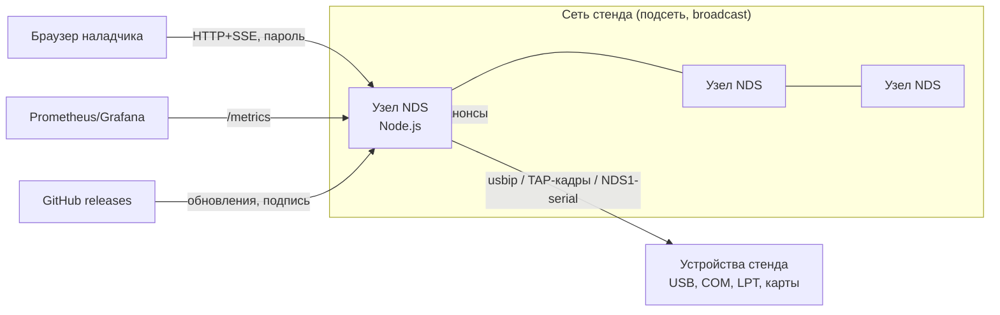

# Обзор архитектуры (TARA)

Ревью по методу TARA (Tiny Architecture Review Approach): контекст → представления «как есть» → соответствие требованиям с оценкой → находки → план. Повторы обзора дописываются новыми датированными разделами снизу, как в LOADTEST. Детали устройства здесь не дублируются — ссылки на [ARCHITECTURE](ARCHITECTURE.md), [PROTOCOL](PROTOCOL.md), [HANDOVER](HANDOVER).

## 2026-11-20 — первый обзор (после слияния i18n + loadtest-веток, d48dd2a)

### 1. Контекст и требования

Система: P2P-приложение для совместного доступа к USB/COM/LPT/сетевым картам в локальной сети стенда. Нефункциональные требования восстановлены из [ARCHITECTURE](ARCHITECTURE.md), [LOADTEST](LOADTEST.md), [HANDOVER](HANDOVER.md) (явно командой не фиксировались — восстановление по документам и коду, как того требует TARA):

| # | Требование | Откуда |
|---|---|---|
| ФТ1 | Каталог устройств всех узлов, занятость, группы, запросы | ARCHITECTURE, HANDOVER-2 |
| ФТ2 | Проброс данных: USB (usbipd), сетевая карта (TAP+мост), COM/LPT — бронь | HANDOVER-2 |
| ФТ3 | Самообновление по сети с подписью и откатом | UPDATE |
| НФТ1 | Ноль зависимостей, ноль сборки, `node src/main.js` | AGENTS, package.json |
| НФТ2 | Без центрального сервера/координатора; владелец — источник истины | ARCHITECTURE |
| НФТ3 | Стойка: десятки узлов; потолок сотни (замер 200 сходятся, 400 — нет) | LOADTEST |
| НФТ4 | Обнаружение падения узла ~минута (по построению 62–92 с) | LOADTEST |
| НФТ5 | Windows-first; Linux — лучше бы жил | HANDOVER-7 |
| НФТ6 | Безопасность LAN: круг доверия, пароль извне, подпись RPC/обновлений | ARCHITECTURE v2/v3 |
| НФТ7 | Ресурсы узла: память ~60 МБ, CPU в покое ~0 (замер) | LOADTEST |

### 2. Как есть — представления

**Контекст (C4-L1).** Диаграмма ниже; подробности — в ARCHITECTURE «Из чего оно состоит».

**Контейнеры/компоненты (C4-L2/L3).** Один процесс на узел; слои и границы — [ARCHITECTURE, диаграмма и «Где что менять»](ARCHITECTURE.md). Кратко: `main` → `core/app` (сборка+снимок) → кластер (`discovery` UDP, `peers` реестр, `directory` обмен) / ядро владения (`shareManager`, `attachManager`, `serialShare`, `netShare`) / транспорт (`rpc`, `tunnels`, `tapLink`, `serialLink`, `vswitch`) / `devices/hub` (платформа за `UsbBackend`: windows/linux/mock) / `api/httpServer` (UI+RPC+SSE) / `update` / статический UI.

**Развёртывание.** Консоль или служба Windows от SYSTEM (автозапуск, HANDOVER-7: на живой машине не проверено); все порты (47811 UDP discovery; HTTP; usbip; 47814 netLink; serial) на всех интерфейсах; настройки `%LOCALAPPDATA%`/`config.json`; установщики драйверов в репо, проверка SHA-256+Authenticode перед запуском.

**Потоки данных.** Анонс=идентичность+`stateHash` (UDP, дешёвое «я здесь») → сосед при смене хеша тянет состояние по HTTP → UI получает весь снимок по SSE при каждом изменении. Данные устройств — прямые TCP к владельцу, посредники их не несут. Критичные уведомления — двойная доставка (прямой вызов + попутно в heartbeat). Живучесть настроек во время аренды — в файле (`netRestore`), не в памяти.

### 3. Соответствие требованиям (оценка 1–5)

| Требование | Оценка | Обоснование |
|---|---|---|
| ФТ1 каталог/занятость | **5** | Аренда+владелец-источник истины; split-brain невозможен по построению; soak 160×60 мин чист |
| ФТ2 пробросы | **4** | USB и сеть карт работают; COM/LPT — только бронь (внешние зависимости, решение за человеком — docs/60_plans/com-lpt.md) |
| ФТ3 самообновление | **4** | Между узлами одной машины — e2e; между компьютерами и поверх старой версии — не проверено (HANDOVER-7) |
| НФТ1 ноль зависимостей | **5** | `dependencies` пуст; насос COM собирается PowerShell Add-Type на месте |
| НФТ2 без координатора | **5** | Посредники только знакомят; нагрузка моста не зависит от числа устройств |
| НФТ3 масштаб стойки | **3** | 200 узлов сходятся (27–36 с); 400 на одной машине — нет: O(N²) broadcast-доставки анонсов (экспонента 1,95, 21 600/с), слой state-лавины снят очередью 12+откат 1–60 с |
| НФТ4 обнаружение падения | **4** | 62–92 с по построению; ping-проверка с гистерезисом ускоряет молчунов; шторм ложных офлайнов подавлен |
| НФТ5 кроссплатформа | **3** | Windows-first всерьёз (INetCfg, TAP, службы); Linux-бэкенд написан, ни разу не запускался |
| НФТ6 безопасность LAN | **4** | Круг=ключ (метка+подпись v2), localhost-всё, извне пароль, сессия=подпись+срок, `X-NDS-UI`; минус: data-plane USB/IP не шифруется (VPN вручную), HTTP-сервер на всех интерфейсах в привилегированном процессе |
| НФТ7 ресурсы | **5** | ~60 МБ/узел, покой ~0% CPU (после отпечатка реестра вместо PowerShell) |

### 4. Метрики кода (2026-11-20)

- 21,6 kLOC исходников (без i18n) + 28,4 kLOC словарей (30 языков) + 5,8 kLOC тестов; 45 тест-файлов, 288 тестов; инварианты — `npm run check` (119).
- Горячие точки: `ui/app.js` 2011, `core/app.js` 1496, `core/netShare.js` 1316, `core/netManager.js` 1115, `cluster/peers.js` 1047 строк. Первые два — за пределами комфортного размера одного файла.
- Связность модулей: зависимость в одну сторону (`app` знает всех), платформа за `UsbBackend` (5 методов), события для рассылки — циклических зависимостей не найдено (визуально по импортам; автоматической проверки нет).
- Покрытие тестами формально не измеряется (`node --test` без coverage-отчёта); косвенно — 288 тестов на 45 файлов, сетевые сценарии на mock-бэкенде между настоящими процессами.
- Документация как часть архитектуры: STATE/HANDOVER/INDEX-дисциплина сильная — редкость, держать.

### 5. Находки (риски), по убыванию важности

1. **[Масштаб] Квадратичная broadcast-сетка анонсов** — единственный подтверждённый потолок 400+ узлов (LOADTEST 11-13). Протокольное решение (темп ×N или одноадрес) требует ADR — см. план.
2. **[Эксплуатация] Проверенность на живом железе отстаёт от кода.** HANDOVER-7: автозапуск от SYSTEM, Linux-бэкенд, байты живого USB, межкомпьютерное самообновление, три сегмента. Каждый пункт — скрытый риск первой установки у заказчика; код «работает по построению».
3. **[Безопасность] Привилегированный процесс слушает все интерфейсы.** Служба от SYSTEM + HTTP на 0.0.0.0 (пароль для записи, чтение состояния свободно). Утёкший/подобранный пароль на старой сборке = запись настроек сети от SYSTEM. Смягчения уже есть (подпись сессии, срок, `X-NDS-UI`), но поверхность стоит признать и держать в REVIEW.
4. **[Безопасность] Data-plane не шифруется** (USB/IP, serial-канал, TAP-кадры) — в LAN допустимо, заявлено честно (VPN вручную); для чужих площадок — ограничитель применимости.
5. **[Поддерживаемость] Два god-файла**: `core/app.js` (сборка всего + снимок) и `ui/app.js` (весь интерфейс). Карта «где что менять» компенсирует, но цена правок растёт (i18n-PR трогал 774 строки ui/app.js).
6. **[Данные] Состояние только в памяти владельца** — перезапуск узла обнуляет занятость (аренды истекают, устройства освобождаются). Для задачи корректно (осознанное решение), но «прожиточные» артефакты (история запросов, журналы занятости) не сохраняются нигде.
7. **[Процесс] Нефункциональные требования явно не зафиксированы** (восстановлены этим обзором из документов) — числа НФТ3/НФТ4 стоит утвердить, иначе непонятно, чего добиваться правками анонс-сетки.

### 6. План улучшений (приоритет, ADR-кандидаты)

| # | Действие | Тип | Приоритет |
|---|---|---|---|
| 1 | ADR: анонс-сетка — темп ×N при росте сети vs одноадресный обмен (PROTOCOL) | протокол | высокий — блокирует НФТ3 |
| 2 | Зафиксировать НФТ числами (узлов, секунд обнаружения, память) в одном месте и утвердить | процесс | высокий — дёшево |
| 3 | Живые проверки по HANDOVER-7 пакетом: 2 машины + перезагрузка (автозапуск, USB-байты, обновление поверх) | эксплуатация | высокий |
| 4 | Coverage-отчёт в CI (`node --test --experimental-test-coverage`) — порог не ставить, сначала видеть | процесс | средний |
| 5 | Расщепить `ui/app.js` и `core/app.js` по вкладкам/областям (движок карточек, сеть, диалоги; сборка vs домены) | рефакторинг | средний |
| 6 | Решение по data-plane шифрованию: туннель NDS для usbip-порта или документированный VPN-профиль | безопасность | средний |
| 7 | COM/LPT транспорт (подпись драйвера — решение за человеком, docs/60_plans/com-lpt.md) | функция | по решению человека |

Общий вердикт: архитектура целостная и последовательно защищает главные инварианты (владелец-источник истины, без посредников для данных, платформа за интерфейсом); слабые места — не структура, а масштаб анонс-сетки (решаемо протокольно) и отставание живой проверки от кода (решаемо эксплуатацией).
